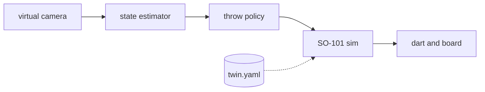

# Robot Arm Darts

A MuJoCo digital twin of an SO-101 robot arm that learns to throw a 10 g dart at a regulation-height dartboard. Everything calibratable lives in `twin.yaml`, so the numbers can be tuned to a real arm once you have one.

Status: early. The arm throws in simulation, and darts fly with drag, stick or bounce, and score on a regulation board, but there is no learned policy yet. Reach is the limit: holding the dart across the fingers (wrist rolled 90°) lets the arm release it along its direction of travel, but at the 4.5 rad/s servo limit it only reaches a board 0.5 m away, and lands low ([feasibility results](docs/v1-feasibility.md)).



Only the arm and dart exist today. The camera, estimator and policy are the next slices ([`SLICES.md`](SLICES.md)).

## Quick start

```bash
make install     # uv sync
make assets      # fetch the Menagerie SO-101 model
make check       # lint, type-check, fast tests
```

Needs Python 3.12 and [uv](https://docs.astral.sh/uv/).

## Usage

Search for the best scripted throw at the board distance in `twin.yaml` (about 10 minutes; add `--maxiter 5` for a quick look):

```console
$ uv run darts throw --scripted --no-video
max release speed seen : 4.33 m/s
best throw             : release 2.49 m/s at 11 deg, 1.70 m high; misses board centre by 0.15 m
release attitude       : 22 deg off its direction of travel, spinning 7.8 rad/s; arrives 40 deg off the board normal
hits the board at 0.5 m? : YES
```

A fast hand always rotates, so the dart leaves spinning and the search judges it by how it arrives (within 0.7 rad of square to the board), then `darts robust` checks the throw against the aero guesses and release timing. It exits 0 on a hit and 1 on a miss, and writes `runs/v1/report.json`. At 1.0 m the answer is NO. Launch a dart in free flight with no arm and see where it lands (exit 0 if it sticks):

```console
$ uv run darts drop --speed 5 --angle 25.7
{"stuck": true, "score": 60, "board_yz_m": [0.0, 0.103], "short_m": 0.0}
```

Score a baseline policy on 100 seeded throws at random board targets (JSON out, exit 0 only if at least 90% reach the board with a median tip error of 3 cm or less):

```console
$ uv run darts eval --policy hand --n 100
{"on_board_rate": 0.71, "stuck_rate": 0.71, "median_tip_error_m": 0.244, "meets_q13": false, ...}
```

`--policy random` reaches the board 0% of the time. Both baselines are saved in `docs/baselines/`.

Fit a base throw for every board target (a search per target, then a cubic map; run it on a pod with `JOB=basemap scripts/pod_train.sh`): `darts basemap --targets 80 --workers 16 --out runs/basemap`. It writes `basemap.json` and held-out results against the hand throw; score it with `darts eval --policy runs/basemap/basemap.json`. The fitted map from the 1.4 m stand is saved as `docs/baselines/basemap.json`: on 100 fresh seeds it sticks 94 to 99% with a median miss of 2.4 to 2.8 cm, against 100% and 6.6 cm for the hand throw (which hugs the board centre).

Train a PPO correction on the hand throw (on a RunPod pod via `scripts/pod_train.sh`, not the laptop): `darts train --steps 200000 --eval-every 10000 --max-seconds 5000`. It logs a held-out `EVAL` line and saves a checkpoint at each interval, aborts on a stop rule, and ends with the held-out result at nominal and extreme aero values in `metrics.json`.

The mast camera (`camera` in `twin.yaml`, ADR-0007) is a 640x480 pinhole on a raised mast 0.6 m to the side of the arm looking at the board centre (`darts visibility` checks the arm never hides more than 2% of the board; `docs/camera-mast.md`); `darts.camera.project` gives the pixel of any world point, checked against a rendered marker to half a pixel. Render one policy throw at a seeded board target to a slow-motion mp4 in a pub corner (a render-only room, `src/darts/room.py`, with no collisions; needs `libosmesa6`, or EGL on a GPU pod; about 80 s with OSMesa):

```console
$ MUJOCO_GL=osmesa uv run darts replay --policy docs/baselines/basemap.json --seed 3 --out runs/replay.mp4
target (+0.050, +0.004) m from centre; stuck=True score=14
video: runs/replay.mp4
```

## Contributing

Conventions are in [`CLAUDE.md`](CLAUDE.md). Training and rendering are meant for a rented GPU pod (RunPod).

## License

Apache-2.0. The SO-101 model comes from [MuJoCo Menagerie](https://github.com/google-deepmind/mujoco_menagerie), also Apache-2.0, and is fetched at setup, not redistributed.
